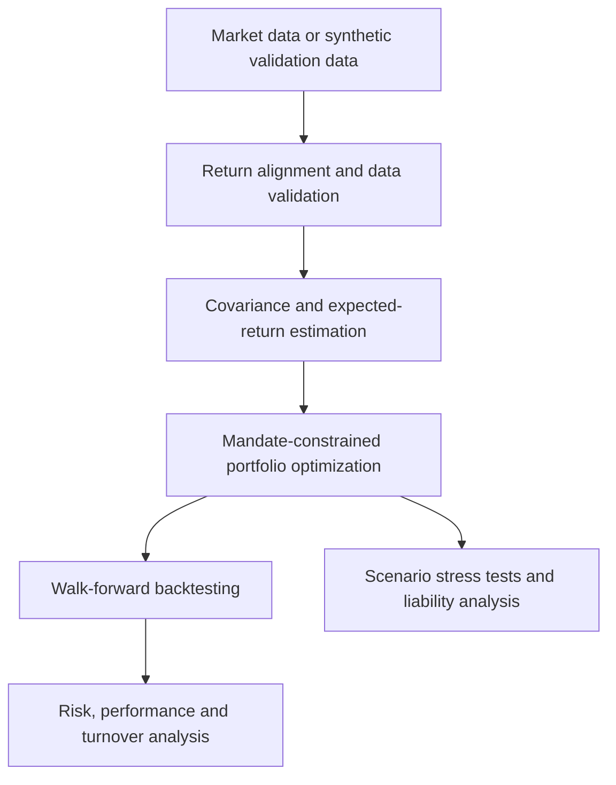

# RiskPath 2.2

**Institutional Multi-Asset Portfolio Research & Risk Analytics**

**[Open interactive research workbench](https://riskpath-workbench.vercel.app)** — browser-based controls, charts and Python calculations; no local installation required.

The web workbench opens in **Personal / Future forecast** mode: select initial capital, monthly contributions, horizon and risk tolerance (0–100). The personal optimizer maps effective risk to a mean-variance risk-aversion coefficient and applies illustrative horizon ceilings (1 year: 30; 3 years: 50; 5 years: 70; 10+ years: 100). It uses fixed long-only constraints; institutional model selection and historical backtesting remain in Institutional mode. This preference mapping is not a validated suitability assessment. It simulates 2,000 joint block-bootstrap paths with quarterly rebalancing and modeled trading costs, beginning on the user's current date. Historical backtesting remains a separate mode. Forecasts are conditional on the selected training data; synthetic data are the default and no live returns are claimed.


A Python research platform for systematic portfolio construction, risk budgeting, liability-relative allocation and chronological backtesting across 28 liquid investment vehicles. RiskPath compares alternative allocation objectives under explicit investment mandates, rather than treating a portfolio as a fixed set of weights.

[Research methodology](riskpath_quant/institutional_research.md) · [Model implementation](riskpath_quant/institutional.py) · [Market-data study](riskpath_quant/market_study.py) · [Run market research](https://github.com/Caydenwan/RiskPath-A-Portfolio-Forecasting-Engine/actions/workflows/riskpath-market-study.yml)

## Research architecture



| Research capability | Current implementation |
|---|---|
| Investment universe | 28 vehicles across seven asset sleeves |
| Mandates | Illustrative pension and liquid multi-strategy policies |
| Optimization | Minimum variance, mean-variance utility, group risk budgeting, empirical CVaR, liability-aware allocation |
| Statistical estimation | Fixed covariance shrinkage, within-sleeve mean shrinkage |
| Execution simulation | Quarterly rebalancing, weight drift, modeled transaction costs |
| Risk analytics | Volatility, excess-return Sharpe, maximum drawdown, expected shortfall, signed risk contributions |
| Liability analytics | Stylized funding ratio and asset-minus-liability return risk |
| Market data | Yahoo Finance via yfinance; completed common monthly returns; explicit coverage and provenance |
| Research validation | Synthetic numerical experiments and automated test suite |

## Investment universe

| Sleeve | Instruments |
|---|---|
| Cash and Treasury bills | BIL |
| Global public equity | VTI, IWM, QQQ, VTV, VEA, VWO |
| Government and global bonds | SHY, IEF, TLT, TIP, BNDX |
| Credit | LQD, HYG, EMB, BKLN |
| Real assets | GLD, DBC, VNQ, IGF |
| Diversifying strategies | DBMF, KMLM, BTAL, QAI, UUP, TAIL |
| Listed private-market proxies | PSP, BIZD |

The investment universe is liquid and exchange-traded. Listed private-market proxies are not direct private-fund investments. Fund-level exposures can include derivatives, shorts and leverage even though portfolio-level vehicle weights are long-only.

## Portfolio mandates

| Sleeve | Pension policy | Liquid multi-strategy policy |
|---|---:|---:|
| Cash | 3–12% | 5–20% |
| Global equity | 25–45% | 10–35% |
| Rates | 15–40% | 10–35% |
| Credit | 5–22% | 5–25% |
| Real assets | 5–22% | 5–25% |
| Diversifiers | 2–20% | 10–35% |
| Listed private-market proxies | 0–10% | 0–10% |

These illustrative policy limits apply at rebalancing. Noncash single-position targets are capped at 18%. The 60/40 benchmark is exempt from mandate constraints.

## Research findings — synthetic validation only

The checked-in experiment uses 240 artificial monthly observations, a 60-month rolling training window and 180 out-of-sample months, with 15 basis points of modeled cost per gross dollar traded.

| Portfolio | CAGR | Annual volatility | Excess Sharpe | Maximum drawdown |
|---|---:|---:|---:|---:|
| 60/40 benchmark | 4.35% | 7.41% | 0.30 | -22.33% |
| Pension policy | 5.56% | 7.59% | 0.44 | -20.66% |
| Pension minimum variance | 4.65% | 2.63% | 0.87 | -4.94% |
| Pension mean-variance | 6.01% | 6.28% | 0.59 | -11.49% |
| Liquid multi minimum variance | 4.66% | 2.04% | 1.13 | -1.52% |
| Liquid multi CVaR | 5.16% | 2.43% | 1.13 | -1.77% |

The stylized liability-aware model reduced asset-minus-liability return volatility from 14.02% to 9.24% relative to the pension policy, while sacrificing asset CAGR. This illustrates the distinction between asset-only optimization and liability-relative objectives.

These figures describe one seeded synthetic experiment, not actual ETF returns, demonstrated alpha, or expected investment performance. See [all metrics](riskpath_quant/institutional_outputs/metrics.csv), [stress tests](riskpath_quant/institutional_outputs/stress.csv) and [experiment metadata](riskpath_quant/institutional_outputs/metadata.json).

## Reproduce the research

Python 3.11 and the dependencies in the research directory.

```bash
cd riskpath_quant
python -m pip install -r requirements.txt
python -m pytest -q
python institutional.py
```

### Historical market-data workflow

```bash
python -m pip install yfinance
python market_study.py
```

The runner retrieves adjusted prices, excludes incomplete months, requires common valid monthly returns, and evaluates eligible 36- and 60-month estimation windows with at least 12 months out of sample. It records coverage, package versions and a data fingerprint. Failures are explicit: no synthetic substitution.

Alternatively, select **RiskPath market data research** in the repository Actions tab and choose **Run workflow**. The job reports aggregate results. Live retrieval and end-to-end historical performance have not yet been verified; there are no confirmed real-market results in this release. The external liability series is not available, so the market-data runner excludes liability-aware optimization.

## Repository structure

| Path | Purpose |
|---|---|
| [riskpath_quant/](riskpath_quant/) | Current research module |
| [institutional.py](riskpath_quant/institutional.py) | Constrained multi-asset allocation, backtest and liability analysis |
| [market_study.py](riskpath_quant/market_study.py) | Historical-data study and provenance |
| [download_returns.py](riskpath_quant/download_returns.py) | Adjusted-price ingestion |
| [engine.py](riskpath_quant/engine.py) | Baseline optimization, performance metrics and block bootstrap |
| [test_institutional.py](riskpath_quant/test_institutional.py) | Institutional model tests |
| [test_engine.py](riskpath_quant/test_engine.py) | Baseline model tests |
| [institutional_research.md](riskpath_quant/institutional_research.md) | Research design, mathematics and results |

The original forecasting notebook and existing ORBIT components are retained for compatibility; the current research entry point is the institutional module.

## Scope and limitations

An independent research prototype, not an institutional production system. Current-universe selection bias, short common histories, estimated transaction costs and the simplified liability model limit interpretation. No direct private-asset valuation, financing or margin model, actuarial cash-flow schedule or independently validated live-market performance is claimed. Data retrieval is subject to provider availability and terms.

**Release 2.2** · Institutional allocation and historical-data research workflow.
