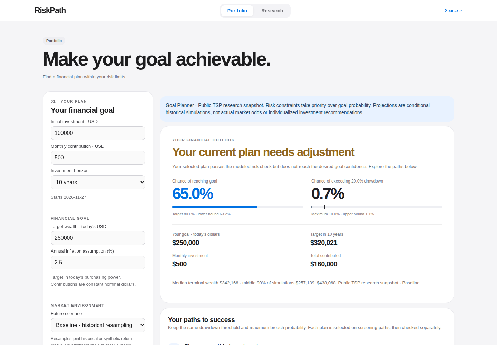
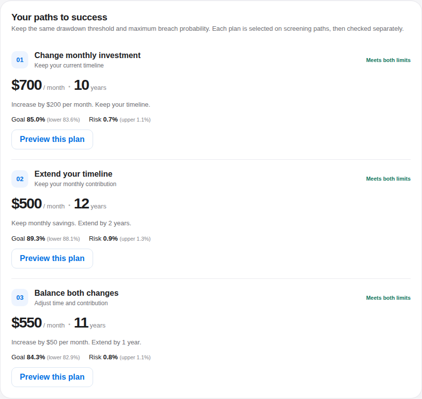
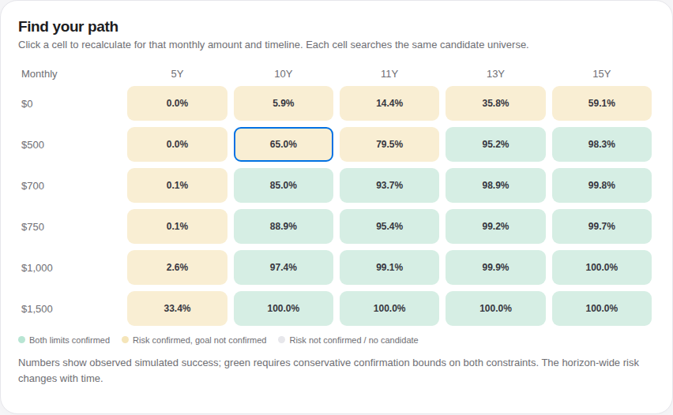
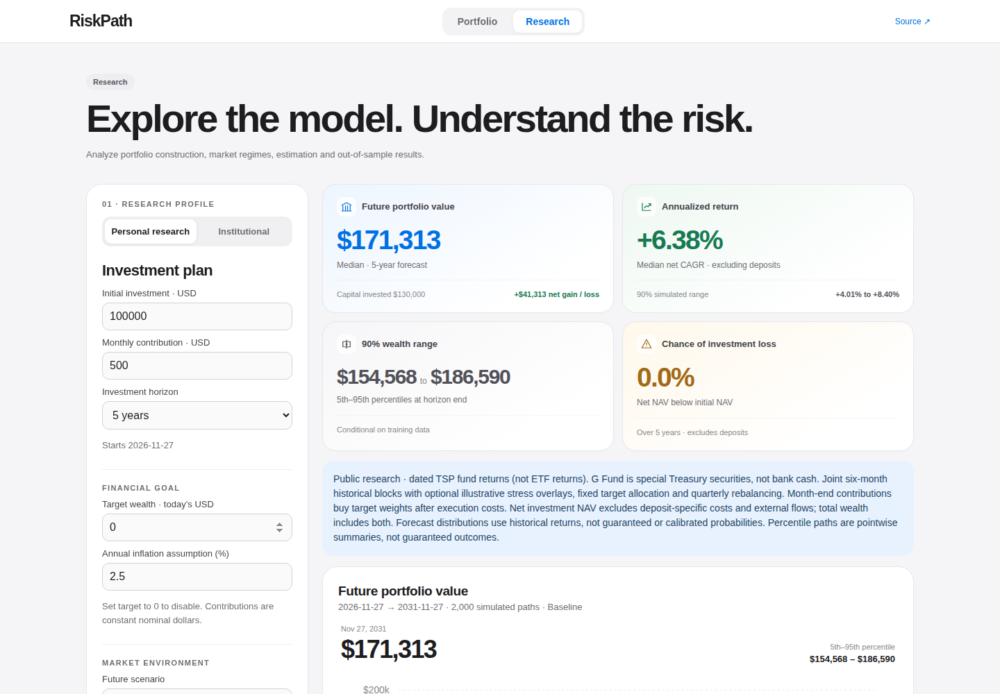
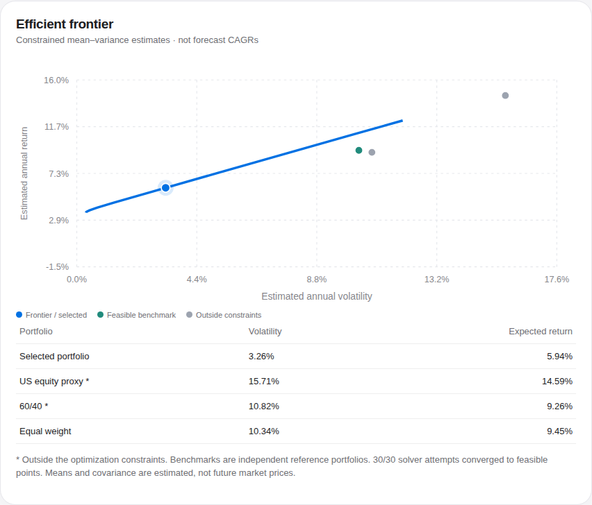
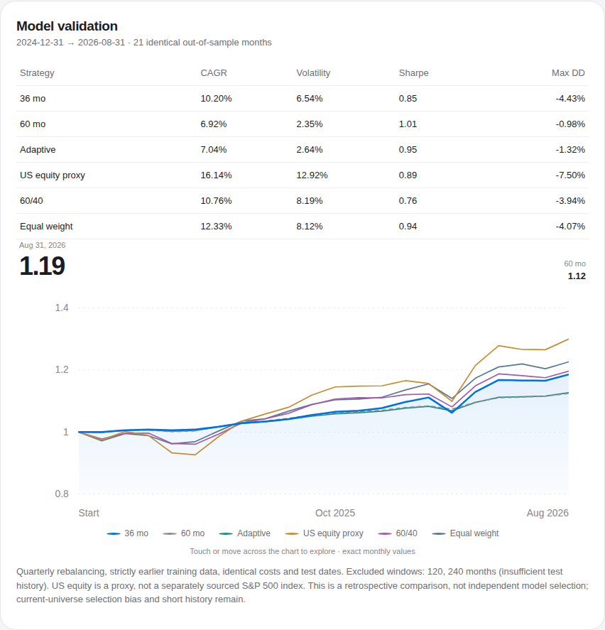
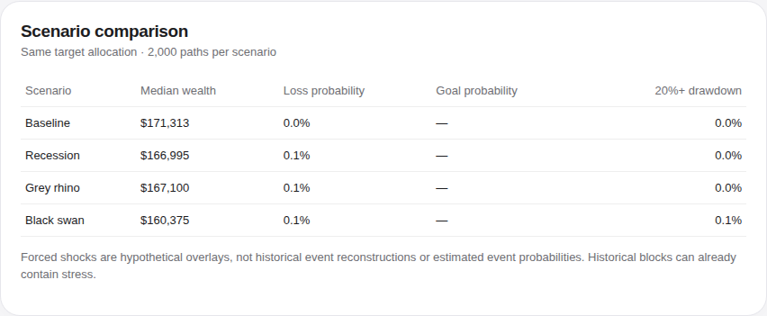
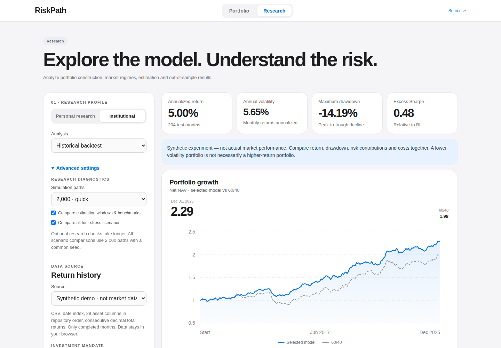
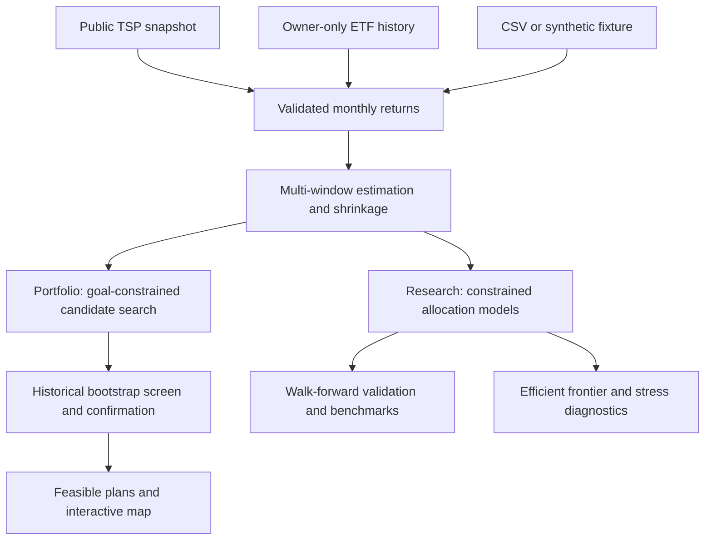

# RiskPath

**Goal-constrained portfolio planning · Multi-asset quantitative research**

An independent browser-based financial research platform that connects goal-based planning, constrained portfolio construction, historical bootstrap simulation and out-of-sample model comparison. Built with Python, NumPy, pandas, SciPy, Pyodide and a lightweight JavaScript interface.

[**Launch Portfolio**](https://riskpath-workbench.vercel.app/?view=portfolio) · [**Launch Research**](https://riskpath-workbench.vercel.app/?view=research) · [Methodology](riskpath_quant/research_v2.md) · [Numerical regression](https://github.com/Caydenwan/RiskPath-Institutional/actions/workflows/riskpath-regression.yml)



*Portfolio workspace, using the published five-fund TSP monthly-return snapshot. The goal and inputs are illustrative; the outputs are computed from the selected data.*

## Two workspaces, one research engine

| Portfolio — financial planning | Research — quantitative analytics |
|---|---|
| Specify financial goal, capital, savings and time horizon | Compare personal and institutional allocation objectives |
| Set maximum drawdown and acceptable breach probability | Efficient frontier, model validation and benchmark comparison |
| Search allocations within the risk budget | Adaptive covariance and expected-return estimation |
| Reverse-solve monthly savings and alternative horizons | Walk-forward backtests, scenario shocks and risk contributions |
| Interactive feasibility map and allocation breakdown | Explicit pension and liquid multi-strategy mandates |

The public demo requires no API key. Advanced Market supports 28 ETFs with owner-authorized private cloud history, direct personal API connection or uploaded CSV. Private API keys and downloaded vendor data are not published in this repository.

## 01 — Portfolio: from a target to a feasible plan

Rather than increasing risk automatically to reach an aspirational return, RiskPath first screens candidate allocations against the user's drawdown constraint, then compares modeled goal success.





The objective is to maximize modeled terminal wealth success over a finite, constrained candidate set:

```math
\max_{w\in\mathcal{C}}\;\widehat{P}(W_T\geq G_0(1+\pi)^T)
```

subject to the modeled probability of exceeding the maximum drawdown threshold remaining within the risk budget. The user specifies the required goal success probability separately.

- Long-only candidate portfolios generated from constrained mean–variance allocations and cash blends.
- Joint six-month historical return blocks drawn using the selected trailing-window mixture.
- 1,000 screening paths and 2,000 separate confirmation paths; one-sided 95% Wilson bounds on simulation success and breach frequencies.
- Monthly rebalancing with modeled purchase, contribution and traded-notional costs.
- Reverse-solve savings on a $50 grid; explore one- to thirty-year horizons without relaxing the risk threshold.
- No allocation displayed when the selected candidate's risk limit is not independently confirmed.

Independent simulation streams address Monte Carlo selection noise, not independent market evidence. The finite search is not a globally optimal solution, and modeled probabilities do not guarantee future outcomes.

[Goal planner implementation](riskpath_quant/goal_planner.py) · [Numerical tests](riskpath_quant/test_goal_planner.py)

## 02 — Research: portfolio construction and validation



The research workspace preserves the original personal mean–variance model and the institutional allocation laboratory. It separates estimated risk and arithmetic expected return from realized historical performance and simulated future wealth.

### Constrained efficient frontier



### Same-period model validation



Fixed 36-, 60-, 120- and 240-month estimation windows and the adaptive blend are compared when sufficient observations exist. Eligible methods use the same out-of-sample dates, quarterly rebalancing and modeled costs. US equity proxy, 60/40 and equal-weight benchmarks use identical test dates; inadequate windows are explicitly excluded.

This is a retrospective research comparison, not a held-out model selection result or evidence of persistent alpha.

### Conditional crisis analysis



Baseline historical resampling, recession, persistent pressure and sudden shocks use the same target allocation and common random numbers. Forced stress overlays are hypothetical, not historical crisis reconstructions or calibrated event probabilities.

### Institutional allocation



*This institutional example uses synthetic returns, not actual ETF performance.*

| Objective | Method |
|---|---|
| Policy reference | Fixed strategic allocation |
| Minimum variance | Minimize estimated portfolio variance |
| Mean–variance | Trade off arithmetic expected return and variance |
| Risk budgeting | Match sleeve-level risk contributions to illustrative targets |
| CVaR | Empirical 95% expected shortfall optimization |
| Liability-aware | Minimize asset-minus-liability return variance with aligned liability data |

Two illustrative mandates constrain target asset-class weights: pension-style and liquid multi-strategy. Liability-aware experiments use stylized synthetic liabilities; no actuarial cash-flow model is claimed.

## Research architecture



| Layer | Implementation |
|---|---|
| Public data | Five TSP funds; 81 completed monthly observations, Dec 2019–Aug 2026; dated snapshot |
| Private data | 28-ETF history; owner-authenticated private Vercel Blob storage; monthly refresh configured, first scheduled execution not independently verified |
| Estimation | Adaptive trailing-window blend; Ledoit–Wolf correlation shrinkage preserving marginal volatility scales |
| Planning | 1,000 screening + 2,000 confirmation paths; monthly target rebalancing |
| Research | 2,000 or 10,000 forecast paths; quarterly rebalancing and modeled costs |
| Runtime | Python calculations in browser via Pyodide; no paid AI API |
| Verification | 58 Python regression tests passed in the latest numerical regression run; browser screenshot workflow uses public or explicitly synthetic data |

### Advanced investment universe

| Sleeve | Instruments |
|---|---|
| Cash / Treasury bills | BIL |
| Global public equity | VTI, IWM, QQQ, VTV, VEA, VWO |
| Government and global bonds | SHY, IEF, TLT, TIP, BNDX |
| Credit | LQD, HYG, EMB, BKLN |
| Real assets | GLD, DBC, VNQ, IGF |
| Diversifiers | DBMF, KMLM, BTAL, QAI, UUP, TAIL |
| Listed private-market proxies | PSP, BIZD |

Portfolio weights are long-only at the vehicle level. Underlying funds can have derivatives, short exposures or leverage; listed private-market proxies are not direct private funds.

## Reproduce and explore

```bash
cd riskpath_quant
python -m pip install -r requirements.txt
python -m pytest -q
python institutional.py
```

| Source | Purpose |
|---|---|
| [goal_planner.py](riskpath_quant/goal_planner.py) | Goal search, drawdown constraints, independent bootstrap confirmation |
| [personal.py](riskpath_quant/personal.py) | Personal allocation candidates |
| [institutional.py](riskpath_quant/institutional.py) | Institutional allocation and walk-forward execution |
| [research.py](riskpath_quant/research.py) | Frontier, same-period validation, scenarios |
| [estimation.py](riskpath_quant/estimation.py) | Moment blending and correlation shrinkage |
| [forecast.py](riskpath_quant/forecast.py) | Research bootstrap and cash-flow simulation |
| [public_research.py](riskpath_quant/public_research.py) | Independent five-fund public model |
| [web/](web/) | Browser workbench, Python worker and protected data endpoint |
| [capture_showcase.py](docs/capture_showcase.py) | Reproducible browser captures of the actual public website |

Additional documentation: [research v2](riskpath_quant/research_v2.md), [institutional research](riskpath_quant/institutional_research.md), [public data provenance](riskpath_quant/public_data.md), [crisis methodology](riskpath_quant/crisis_research.md), [offline market study](riskpath_quant/market_study.py).

## Limitations

Independent research prototype, not an institutional production system or individualized investment advice. Limited common history, current-universe selection bias, uncertain expected returns, simplified execution costs and monthly (not intramonth) drawdowns constrain interpretation. Historical simulation is not a calibrated forecast; scenario overlays may double-count stress. Real-market strategy superiority, long-run forecast calibration and first scheduled private refresh remain unverified. The public TSP snapshot is dated; private vendor returns are not redistributed.

**Author:** Yunhao (Cayden) Wan · Finance & Business Analytics
